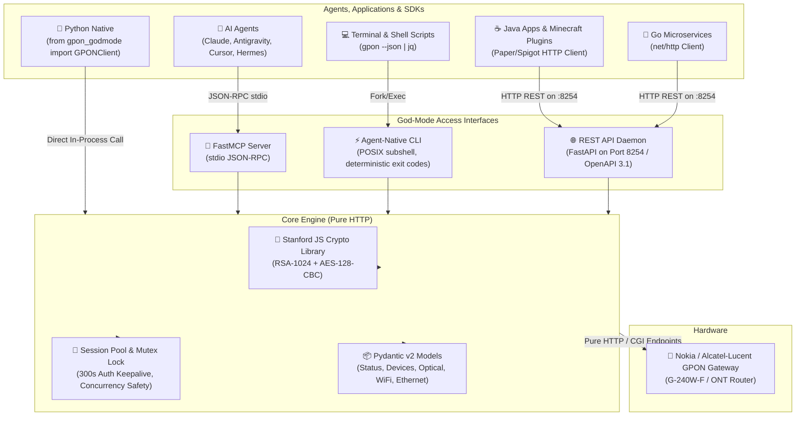

# GPON God-Mode 🚀

[](LICENSE)
[](https://python.org)
[](https://fastapi.tiangolo.com)
[](https://modelcontextprotocol.io)
[]()

An agent-native automation toolkit, CLI, **Model Context Protocol (MCP)** server, and **REST API Daemon** for Nokia/Alcatel-Lucent GPON Home Gateways (such as the G-240W-F).

GPON God-Mode completely bypasses ISP web interface restrictions and executes router actions over **100% pure HTTP** using the router's reverse-engineered SJCL encryption (RSA-1024 + AES-128-CBC). 

> **Zero browser binaries, zero Playwright/Puppeteer overhead, <25MB RAM, and 150ms–300ms sub-second execution.**

---

## 🏛️ System Architecture



---

## ✨ Features

- ⚡ **100% Browserless & Fast**: Replaces heavy headless Chromium with pure HTTP requests. Operations execute in ~200ms instead of 15 seconds.
- 🤖 **Native FastMCP Server**: Built-in Model Context Protocol server (`gpon-mcp`) with 12 specialized tools for Claude Desktop, Antigravity, Cursor, and Hermes Agent.
- 🌐 **REST API Daemon (Port 8254)**: Production-grade local FastAPI daemon running on niche port `8254` (preventing collisions with dev ports 3000/5000/8080) with interactive Swagger docs and OpenAPI 3.1.
- 📊 **Deterministic JSON CLI**: Every CLI subcommand accepts `--json`, outputting strict Pydantic v2 schemas with deterministic exit codes (`0` for success, non-zero for failure).
- 🔬 **Fiber Optic Telemetry**: Reads optical transceiver TX/RX power in dBm, laser bias current, and temperature according to ITU-T G.984 Class B+ standards.
- 🔌 **Physical Ethernet Speed Detection**: Real-time physical link inspection (LAN1–LAN4) to detect Gigabit (1000M) vs 100M Fast Ethernet cable bottlenecks and packet drops.
- 📶 **Wi-Fi Channel Optimization**: Audit 2.4GHz radio parameters and switch channels (1–13) on-the-fly to avoid interference.
- 🎮 **One-Click Gaming Latency Macro**: Puts gaming consoles/PCs into DMZ (Open NAT), disables naive DoS firewall false-positives, disables voice-corrupting ALGs (SIP/RTSP), and enables UPnP.
- 🔍 **Real-Time Client Discovery**: Discovers all active and historical LAN/Wi-Fi devices with IP, MAC, hostname, and connection type.
- 🛡️ **NAT & DMZ Automation**: Add, list, and delete port forwarding rules with zero UI interaction.

---

## 🚀 Quick Start

### 1. Installation

```bash
# Clone repository
git clone https://github.com/your-username/gpon-godmode.git
cd gpon-godmode

# Setup virtual environment & dependencies
python3 -m venv venv
source venv/bin/activate
pip install -e ".[mcp]"

# Configure router credentials
cp .env.example .env
```

Edit `.env` with your gateway credentials:
```ini
ROUTER_IP=http://192.168.1.254
ROUTER_USER=userAdmin
ROUTER_PASS=your_admin_password
GPON_API_PORT=8254
GPON_API_HOST=127.0.0.1
```

---

### 2. CLI Usage

The `./gpon.sh` CLI wrapper provides human-formatted tables by default, and strict JSON when `--json` is supplied:

```bash
# Gateway status & temperature
./gpon.sh status

# Discover connected LAN & Wi-Fi clients
./gpon.sh devices

# Fiber optic power telemetry (RX/TX dBm)
./gpon.sh optical

# Physical Ethernet LAN port link speeds (1000M vs 100M bottleneck)
./gpon.sh ethernet

# 2.4GHz Wi-Fi status & channel switching
./gpon.sh wifi status
./gpon.sh wifi channel 6

# View active port forwards
./gpon.sh ports list

# Add port forward (WAN 25565 -> LAN 192.168.1.154:25565 TCP)
./gpon.sh ports add 25565 25565 192.168.1.154 --proto TCP

# Delete port forward by external port
./gpon.sh ports del 25565

# Manage DMZ host
./gpon.sh dmz get
./gpon.sh dmz set 192.168.1.74
./gpon.sh dmz disable

# One-click gaming latency & Open NAT optimization
./gpon.sh gaming 192.168.1.74

# Update LAN DHCP DNS servers
./gpon.sh dns 1.1.1.1 1.0.0.1

# Soft-reboot the gateway
./gpon.sh reboot
```

#### Headless Agent Mode (`--json`)
Append `--json` to any command for machine-readable JSON pipelines:
```bash
./gpon.sh optical --json | jq -r '.data | "RX Power: \(.rx_power_dbm) dBm (\(.signal_quality))"'
```

---

### 3. Model Context Protocol (MCP) Setup

Add to your agent configuration (`claude_desktop_config.json`, `.cursor/mcp.json`, or Antigravity):

```json
{
  "mcpServers": {
    "gpon": {
      "command": "/home/noe/Projects/gpon-godmode/venv/bin/gpon-mcp",
      "env": {
        "ROUTER_IP": "http://192.168.1.254",
        "ROUTER_USER": "userAdmin",
        "ROUTER_PASS": "your_password"
      }
    }
  }
}
```

The MCP server registers 12 agent-native tools:
- `gpon_get_status`
- `gpon_get_devices`
- `gpon_get_optical_status`
- `gpon_get_wifi_config`
- `gpon_set_wifi_channel`
- `gpon_get_ethernet_ports`
- `gpon_list_port_forwards`
- `gpon_add_port_forward`
- `gpon_delete_port_forward`
- `gpon_set_dmz`
- `gpon_optimize_gaming`
- `gpon_reboot`

Detailed tool parameters and agent decision trees are documented in [`docs/AGENTS.md`](docs/AGENTS.md).

---

### 4. REST API Daemon (Port 8254 & Zero-RAM Auto-Sleep)

Launch the REST daemon for local backends, web dashboards, or game server plugins:

```bash
# Persistent daemon
./gpon.sh daemon --port 8254

# Or standalone with auto-sleep after 60s of inactivity (frees 100% RAM)
./gpon.sh daemon --port 8254 --idle-timeout 60
```

- **Base URL**: `http://127.0.0.1:8254`
- **Interactive Swagger Docs**: `http://127.0.0.1:8254/docs`
- **OpenAPI 3.1 Spec**: `http://127.0.0.1:8254/openapi.json`
- **Environment Override**: `GPON_API_PORT=8254`

#### 💤 True Zero-RAM On-Demand Sleep (systemd Socket Activation)
You can keep port `8254` always listening while consuming **0 MB RAM** when idle:

```bash
# Enable on-demand socket activation (Linux systemd user service)
./gpon.sh enable-service

# Check status
./gpon.sh service-status

# Disable service
./gpon.sh disable-service
```
* **How it works:** `systemd` listens on port `8254` via kernel socket (**0 MB RAM**).
* When a request arrives (from your Minecraft plugin, Go service, or browser), systemd wakes up the daemon in ~250ms.
* The daemon stays hot in memory for 1 minute (subsequent calls take <5ms).
* After 1 minute of silence, the daemon gracefully terminates and releases **100% of its RAM**.
* Port 8254 remains open in the kernel, ready for the next call!

---

## 📡 Router Telemetry & Gaming Optimization

### 1. Fiber Optic Telemetry (ITU-T G.984 Class B+)
GPON God-Mode queries the internal transceiver diagnostics (`wan_status.cgi?gpon`) and converts raw milliwatts into decibel-milliwatts ($\text{dBm}$):

$$\text{Power}_{\text{dBm}} = 10 \cdot \log_{10}(\text{RawPower} \cdot 10^{-4})$$

| RX Optical Power | Signal Health | Operational Impact |
| :--- | :--- | :--- |
| **$> -8.0\text{ dBm}$** | ⚠️ Overload | Optical receiver saturation, potential hardware damage. Attenuator needed. |
| **$-8.0\text{ to } -24.9\text{ dBm}$** | ✅ Healthy / Optimal | Nominal Class B+ budget. Max speed, zero packet loss. |
| **$-25.0\text{ to } -27.9\text{ dBm}$** | 🟡 Marginal | Micro-disconnects, packet jitter under heavy bandwidth. Check fiber bends. |
| **$< -28.0\text{ dBm}$** | 🚨 Critical Attenuation | Below receiver sensitivity. Frequent PPPoE drops. Technician call required. |

### 2. Ethernet Link Speed & Bottleneck Diagnostics
Often, a PC or console experiences speed caps because a faulty Cat5 cable or intermediate switch negotiated at **100 Mbps Fast Ethernet** instead of **1000 Mbps Gigabit**. GPON God-Mode queries physical MAC/PHY registers for LAN1–LAN4:
```bash
./gpon.sh ethernet
```

### 3. One-Click Gaming Optimization Macro
```bash
./gpon.sh gaming 192.168.1.74
```
This macro executes 4 critical network optimizations simultaneously:
1. **DMZ Placement**: Redirects unmatched incoming UDP/TCP traffic directly to the gaming host, achieving Open NAT in Call of Duty, Fortnite, and Xbox Live.
2. **Disable DoS Filter**: The router's stock firewall mistags rapid UDP matchmaking bursts as SYN/UDP flood attacks, dropping packets. God-mode disables this filter.
3. **Disable Voice-Corrupting ALGs**: Disables SIP, RTSP, and H.323 Application Layer Gateways which rewrite packet headers and corrupt Discord, PlayStation Party, and VoIP traffic.
4. **Enable UPnP**: Allows games to dynamically request incoming ports.

---

## 💻 Multi-Language SDK Integration

### Python SDK
```python
from gpon_godmode import GPONClient

with GPONClient() as client:
    status = client.get_status()
    print(f"Connected to {status.model_name} (WAN IP: {status.wan_ip})")

    optical = client.get_optical_status()
    print(f"Optical RX: {optical.rx_power_dbm} dBm | Quality: {optical.signal_quality}")

    # Optimize for gaming rig
    result = client.optimize_gaming("192.168.1.74")
    print(result.message)
```

### Java SDK (Minecraft Server Plugin & Standalone)
The Java SDK (`sdk/java`) has zero external dependencies, targets Java 11+, and includes built-in fallback to `gpon <cmd> --json` via process execution if the daemon is offline:

```java
import com.gpon.godmode.GponClient;
import com.gpon.godmode.OpticalStatus;

// Connects to local daemon on port 8254 with automatic CLI fallback
GponClient client = GponClient.builder()
    .port(8254)
    .fallbackToCli(true)
    .build();

// 1. Check fiber line health
OpticalStatus optical = client.getOpticalStatus();
System.out.println("Fiber RX: " + optical.getRxPowerDbm() + " dBm (" + optical.getSignalQuality() + ")");

// 2. Automate Minecraft server hosting (Paper / Spigot plugin)
client.addPortForward(25565, 25565, "192.168.1.154", "TCP");

// 3. One-click gaming latency optimization for server host
client.optimizeGaming("192.168.1.154");
```

### Go SDK (Microservices & Daemon Bridge)
The Go SDK (`sdk/go`) provides a typed, context-aware client with functional options and automatic CLI fallback:

```go
package main

import (
    "context"
    "fmt"
    "time"

    "github.com/noecodes/gpon-godmode/sdk/go"
)

func main() {
    client := gpon.NewClient(
        gpon.WithAPIPort(8254),
        gpon.WithCLIFallback(true),
        gpon.WithTimeout(10 * time.Second),
    )

    ctx, cancel := context.WithTimeout(context.Background(), 5*time.Second)
    defer cancel()

    optical, err := client.GetOpticalStatus(ctx)
    if err != nil {
        panic(err)
    }
    fmt.Printf("Fiber RX: %.2f dBm (%s)\n", optical.RXPowerDBm, optical.SignalQuality)

    // Forward port for hosting
    _ = client.AddPortForward(ctx, gpon.PortForwardRequest{
        ExternalPort: 25565,
        InternalPort: 25565,
        ServerIP:     "192.168.1.154",
        Protocol:     "TCP",
    })
}
```

---

## ⚙️ Configuration Reference

All settings can be configured via environment variables or `.env`:

| Variable | Type | Default | Description |
| :--- | :--- | :--- | :--- |
| `ROUTER_IP` | String | `http://192.168.1.254` | Web management URL of the GPON gateway. |
| `ROUTER_USER` | String | `userAdmin` | Admin username for web login. |
| `ROUTER_PASS` | String | *(Empty)* | Admin password for web login. |
| `GPON_API_PORT` | Integer | `8254` | Port for the local FastAPI REST API Daemon. |
| `GPON_API_HOST` | String | `127.0.0.1` | Bind address for the local REST daemon. |

---

## 📖 Further Documentation

- **[`docs/AGENTS.md`](docs/AGENTS.md)**: Dedicated agent integration manual, MCP tool catalog, deterministic JSON CLI contract, and automated troubleshooting recipes.
- **[`SKILL.md`](SKILL.md)**: Compact skill specification for Antigravity, Claude, and Cursor skill loaders.
- **[`research/`](research/)**: Full reverse-engineering documentation, captured CGI frames, and SJCL crypto analysis.

---

## 🎯 Supported Hardware & Limitations

This project was built and reverse-engineered specifically out of necessity for:
* **Router Model**: **Nokia / Alcatel-Lucent G-240W-F** (GPON Home Gateway)
* **ISP**: **Algérie Télécom** (Idoom Fibre)
* **Hardware Revision**: `3FE46597AAAA`
* **Firmware Version**: `3FE46606BGBB24` (EcoNet/MediaTek MTK7526G SoC, U-Boot Dec-31-2016)
* **Authentication**: Stanford JavaScript Crypto Library (SJCL) RSA-1024 + AES-128-CBC encryption over custom CGI endpoints.

### Limitations
* **Model Specificity**: Tested and confirmed working on the Nokia G-240W-F distributed by Algérie Télécom. Other firmware revisions or routers from other ISPs (Huawei EchoLife, ZTE F660/F670, Fiberhome, Sagemcom) use different authentication schemes (HTTP Digest, MD5 challenges, different public keys) and different internal CGI endpoints.
* **Scope**: This is an independent, community-driven project aimed at fixing real-world gaming latency and automation headaches, not an official enterprise network management suite.

---

## 🤝 Contributing: Add Your Own Router!

If you have a different ISP router or GPON gateway (Huawei, ZTE, Fiberhome, D-Link, etc.) and want to automate it or bypass its web UI restrictions, **contributions are warmly welcome!**

* Feel free to submit a Pull Request adding an adapter or client for your router model.
* If you reverse-engineer your router's login or port forwarding endpoints, open an issue or PR so others on your ISP can benefit.

---

## 📜 License

MIT License. Designed and maintained for network engineers, gamers, and autonomous AI agents.

