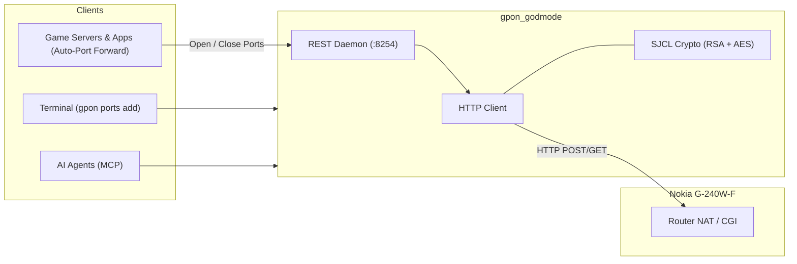

# gpon-godmode

I made this so I could open ports without having to log into my router's web dashboard every time, and so my server apps (Minecraft servers, game lobbies, self-hosted backends) can open the ports they need automatically.

It targets the **Nokia / Alcatel-Lucent G-240W-F** fiber router distributed by Algérie Télécom. Logging into that web interface just to forward a port for a game or server is painfully slow and clunky. This project reverse-engineers the frontend's login crypto (RSA-1024 + AES-128-CBC) to talk straight to the router's internal CGI endpoints over plain HTTP in ~200ms. No browser automation or Playwright required.



---

## What it does

- **Automated port forwarding for server apps**: Let your game servers or backends request port forwards on startup and clean them up on shutdown. Comes with a zero-dependency Java SDK (including an auto-forwarding Paper/Spigot Minecraft plugin) and a Go SDK.
- **Port management without the web UI**: Open, list, or delete NAT port forwards straight from your terminal (`./gpon.sh ports add 25565 25565 192.168.1.154`) or via a local REST API on port `8254`.
- **Zero-RAM sleep (systemd socket activation)**: The local API daemon can sleep at 0 MB RAM until a server app calls it to forward a port, stay warm in memory for 60 seconds, and shut down automatically when idle.
- **Gaming latency fix**: One command (`./gpon.sh gaming <ip>`) to put your gaming rig into DMZ, turn on UPnP, and disable the broken firewall DoS filter and voice-corrupting ALGs that drop packets in games like Fortnite.
- **Line diagnostics**: Read fiber optic signal power (TX/RX dBm) and check physical LAN port speeds (1000M vs 100M cable bottlenecks).
- **AI Agent support**: Built-in Model Context Protocol (MCP) server so agents in Claude or Cursor can manage router settings.

---

## Setup

```bash
git clone https://github.com/bsiamer/gpon-godmode.git
cd gpon-godmode

python3 -m venv venv
source venv/bin/activate
pip install -e ".[mcp]"

cp .env.example .env
```

Set your router credentials in `.env`:

```ini
ROUTER_IP=http://192.168.1.254
ROUTER_USER=userAdmin
ROUTER_PASS=your_password
GPON_API_PORT=8254
GPON_API_HOST=127.0.0.1
```

---

## CLI

The `./gpon.sh` wrapper runs in your current shell and maps commands directly to the core package:

```bash
# Check router status, uptime, CPU temp, and WAN IP
./gpon.sh status

# List connected LAN and Wi-Fi devices
./gpon.sh devices

# Fiber optic power levels (TX/RX dBm)
./gpon.sh optical

# Check LAN 1-4 link speeds (spot 100M cable caps)
./gpon.sh ethernet

# Check or change Wi-Fi channel
./gpon.sh wifi status
./gpon.sh wifi channel 6

# Port forwarding
./gpon.sh ports list
./gpon.sh ports add 25565 25565 192.168.1.154 --proto TCP
./gpon.sh ports del 25565

# DMZ (routes all unsolicited traffic to target; add -y to skip prompt)
./gpon.sh dmz get
./gpon.sh dmz set 192.168.1.74 -y
./gpon.sh dmz disable

# Fix gaming packet drops (DMZ + disable DoS filter + disable SIP ALG + UPnP)
./gpon.sh gaming 192.168.1.74 -y

# Change DHCP DNS servers
./gpon.sh dns 1.1.1.1 1.0.0.1

# Soft-reboot
./gpon.sh reboot
```

Add `--json` to any command for structured output:
```bash
./gpon.sh optical --json
```

---

## Model Context Protocol (MCP)

Add this to your MCP client config (`claude_desktop_config.json`, `.cursor/mcp.json`, or Antigravity):

```json
{
  "mcpServers": {
    "gpon": {
      "command": "/home/noe/Projects/gpon-godmode/venv/bin/gpon-mcp",
      "env": {
        "ROUTER_IP": "http://192.168.1.254",
        "ROUTER_USER": "userAdmin",
        "ROUTER_PASS": "your_password"
      }
    }
  }
}
```

The server exposes 12 tools covering router status, devices, optical power, Wi-Fi channel selection, Ethernet speeds, port forwards, DMZ, and gaming optimization. Full parameter references are in [`docs/AGENTS.md`](docs/AGENTS.md).

---

## REST API & Socket Activation

If you have local services that need router automation, you can run the daemon on port 8254:

```bash
# Run persistently in foreground
./gpon.sh daemon --port 8254

# Or exit after 60s of silence to save RAM
./gpon.sh daemon --port 8254 --idle-timeout 60
```

Swagger UI is at `http://127.0.0.1:8254/docs` and the OpenAPI spec is at `/openapi.json`.

### Zero-RAM On-Demand Sleep (Linux / systemd)

On Linux systems running systemd, you don't need a Python process sitting in RAM 24/7. Systemd can hold port 8254 in the kernel at 0 MB RAM, launch the daemon on the first request, keep it warm for 60 seconds, and kill it when idle:

```bash
# Enable user socket activation
./gpon.sh enable-service

# Check service and socket status
./gpon.sh service-status

# Disable
./gpon.sh disable-service
```

---

## Fiber Telemetry & Gaming Optimization

### Optical signal levels

The router reads transceiver data via `wan_status.cgi?gpon`. Raw milliwatts get converted to dBm:

$$\text{dBm} = 10 \cdot \log_{10}(\text{RawPower} \cdot 10^{-4})$$

| RX Power | State | What it means |
| :--- | :--- | :--- |
| $> -8.0\text{ dBm}$ | Overload | Signal too strong. Optical receiver saturates; needs an attenuator. |
| $-8.0\text{ to } -24.9\text{ dBm}$ | Good | Standard Class B+ budget. Clean line rate. |
| $-25.0\text{ to } -27.9\text{ dBm}$ | Marginal | High attenuation. Jitter and micro-drops under load. Check for tight bends. |
| $< -28.0\text{ dBm}$ | Critical | Below sensitivity limit. Periodic PPPoE drops. Call your ISP. |

### Why the gaming macro exists

Algérie Télécom's stock firmware has three quirks that ruin games like Fortnite, Call of Duty, and voice chat:
1. **Broken DoS filter**: Rapid UDP matchmaking bursts trigger the router's "Attack Protection", dropping packets mid-game.
2. **SIP / RTSP ALGs**: These rewrite packet payloads thinking they're helping VoIP, but end up corrupting Discord, PlayStation Party, and game traffic.
3. **Strict NAT**: Without UPnP or DMZ, inbound game sessions get blocked.

Running `./gpon.sh gaming <your-ip>` disables the DoS filter, turns off the bad ALGs, enables UPnP, and routes unmatched traffic to your machine via DMZ.

> **Security warning:** Putting a device in DMZ and disabling the DoS filter exposes that machine directly to all unsolicited internet traffic. Only run this for a gaming console or a PC with its own local firewall running (like Windows Firewall or ufw/nftables), never for an unprotected device or a machine hosting sensitive unauthenticated services.

---

## SDKs

### Python
```python
from gpon_godmode import GPONClient

with GPONClient() as client:
    status = client.get_status()
    print(f"Model: {status.model_name} | IP: {status.wan_ip}")

    optical = client.get_optical_status()
    print(f"Fiber RX: {optical.rx_power_dbm} dBm ({optical.signal_quality})")

    client.optimize_gaming("192.168.1.74")
```

### Java (Minecraft Paper/Spigot Plugin & Standalone)
Located in [`sdk/java`](sdk/java). Zero third-party dependencies (pure Java 11 `HttpClient` + minimal JSON parser). Falls back to running `gpon <cmd> --json` via process execution if the HTTP daemon isn't running.

Includes a ready-to-build Paper/Spigot plugin that forwards port 25565 on server startup, monitors fiber line health, and deletes the rule on server stop.

```java
import com.gpon.godmode.GponClient;

GponClient client = GponClient.builder()
    .port(8254)
    .fallbackToCli(true)
    .build();

// Forward port for your server
client.addPortForward(25565, 25565, "192.168.1.154", "TCP");
```

### Go
Located in [`sdk/go`](sdk/go). Standard library only (`net/http`, `context`).

```go
package main

import (
    "context"
    "fmt"
    "time"

    "github.com/bsiamer/gpon-godmode/sdk/go"
)

func main() {
    client := gpon.NewClient(
        gpon.WithAPIPort(8254),
        gpon.WithCLIFallback(true),
    )

    ctx, cancel := context.WithTimeout(context.Background(), 5*time.Second)
    defer cancel()

    optical, err := client.GetOpticalStatus(ctx)
    if err != nil {
        panic(err)
    }
    fmt.Printf("Fiber RX: %.2f dBm (%s)\n", optical.RXPowerDBm, optical.SignalQuality)
}
```

---

## Supported Hardware & Limitations

This was reverse-engineered specifically for my home setup:
- **Router**: Nokia / Alcatel-Lucent G-240W-F (GPON Home Gateway)
- **ISP**: Algérie Télécom (Idoom Fibre)
- **Hardware Revision**: `3FE46597AAAA`
- **Firmware Version**: `3FE46606BGBB24` (EcoNet/MediaTek MTK7526G SoC, U-Boot Dec-31-2016)

### Limitations
Other ISPs and other GPON models (Huawei HG8245, ZTE F660/F670, Fiberhome, Sagemcom) use completely different login flows (HTTP digest auth, challenge-response salts, different public keys) and different internal CGI endpoints. This tool won't work out of the box on those without an adapter.

---

## Contributing

I don't intend to turn this into a giant enterprise project, but if you're dealing with a locked-down router from your ISP and want to add support for your model, PRs are welcome.

---

## License

MIT
